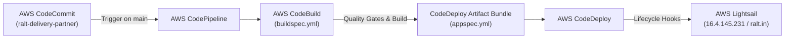

# AWS CI/CD Pipeline & Lightsail Deployment Architecture

This document details the enterprise AWS CI/CD pipeline setup for the **RALT ONDC Logistics Service Provider (BPP)** deployed to **AWS Lightsail**.

---

## 🏗️ Architecture Overview



---

## 📦 Pipeline Specifications

### 1. Source Stage (AWS CodeCommit)
- **Repository**: `ralt-delivery-partner`
- **Branch**: `main`
- **Output Artifact**: `SourceArtifact`
- **Change Detection**: CloudWatch Events / EventBridge automatic trigger on commit.

---

### 2. Build Stage (AWS CodeBuild)
- **Buildspec**: [`buildspec.yml`](../buildspec.yml)
- **Environment**: Linux Container (`aws/codebuild/standard:7.0` or Ubuntu 22.04+)
- **Runtime**: Node.js 22.x
- **Quality Gates Enforced**:
  1. **Static Analysis & Linting**: `npm run lint` (`tsc --noEmit` across backend and delivery app)
  2. **Security & Quality Scan**: `npm run scan` (`scripts/security-scan.sh` — dependency audit, secret scanning, zero technical jargon check)
  3. **Unit Tests with Coverage**: `npm run test:coverage` (Strict **>= 85% Lines Coverage** on both Frontend and Backend)
  4. **Compilation**: `(cd services/ondc-lsp-service && npm run build)`
- **Output Artifact**: `BuildArtifact` (contains `appspec.yml`, `deploy/**/*`, `services/ondc-lsp-service/**/*`, `packages/**/*`, `package.json`).

---

### 3. Deploy Stage (AWS CodeDeploy)
- **Application Name**: `ralt-ondc-application`
- **Deployment Group**: `ralt-ondc-lightsail-group`
- **Deployment Type**: In-Place
- **Environment**: On-Premises / External Instance (`ralt-ondc` registered via CodeDeploy Agent)
- **AppSpec**: [`appspec.yml`](../appspec.yml)
- **Lifecycle Hooks**:
  - `ApplicationStop`: [`deploy/codedeploy/ApplicationStop.sh`](./codedeploy/ApplicationStop.sh) — gracefully pauses running service.
  - `BeforeInstall`: [`deploy/codedeploy/BeforeInstall.sh`](./codedeploy/BeforeInstall.sh) — snapshots state and backs up `.env` and SQLite data.
  - `AfterInstall`: [`deploy/codedeploy/AfterInstall.sh`](./codedeploy/AfterInstall.sh) — restores configuration, installs production dependencies, and verifies permissions.
  - `ApplicationStart`: [`deploy/codedeploy/ApplicationStart.sh`](./codedeploy/ApplicationStart.sh) — reloads cluster process with zero downtime using PM2 (`pm2 reload ralt-ondc --update-env`).
  - `ValidateService`: [`deploy/codedeploy/ValidateService.sh`](./codedeploy/ValidateService.sh) — polls `http://127.0.0.1:5000/health` with exponential retries until HTTP 200 OK.

---

## 🖥️ AWS Lightsail Server Details

- **Instance Name**: `ralt-ondc`
- **Region**: `ap-south-1` (Mumbai)
- **Public IP**: `16.4.145.231`
- **Production Domain**: `https://ralt.in` / `https://www.ralt.in`
- **Host Runtime**: Ubuntu 24.04 LTS (Noble Numbat)
- **Reverse Proxy**: Nginx (ports 80 & 443 with Let's Encrypt SSL certificates automatically forwarding to `127.0.0.1:5000`)
- **Process Manager**: PM2 (`ralt-ondc`, 10MB memory footprint, auto-restart on crash)
- **CodeDeploy Host Agent**: Active and listening via systemd (`codedeploy-agent.service`).

---

## ⚡ Direct Deployment & Testing CLI

To manually trigger or verify deployment to Lightsail at any time:
```bash
bash scripts/deploy-lightsail-live.sh
```

To verify live health:
```bash
curl -s https://ralt.in/health | jq .
```
Expected response:
```json
{
  "status": "ok",
  "version": "1.2.6-enterprise",
  "service": "RALT ONDC Logistics Provider (BPP)",
  "subscriber_id": "ralt.in",
  "domain": "ONDC:LOG10",
  "role": "BPP",
  "database_engine": "sqlite",
  "time": "..."
}
```

