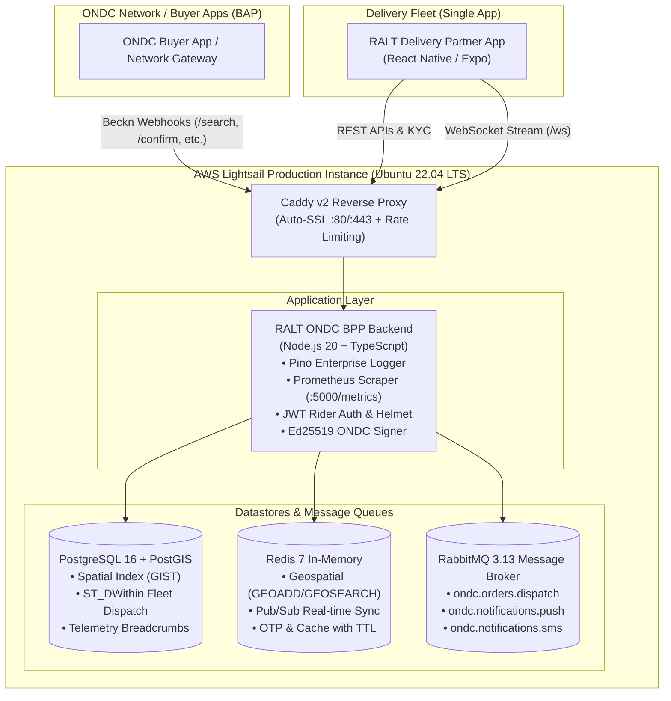

# RALT ONDC Logistics Provider (BPP) — AWS Lightsail Production Deployment Architecture

Production-grade deployment architecture for the **RALT ONDC Logistics Service Provider (BPP)** backend and the **Delivery Partner App** on **AWS Lightsail**.

---

## 🏛️ System Architecture



---

## 🛡️ Enterprise Capabilities Implemented

### 1. Security Standards
- **Helmet HTTP Hardening:** Content Security Policy (CSP), HTTP Strict Transport Security (HSTS with 1-year preload), `X-Frame-Options: DENY`, `X-Content-Type-Options: nosniff`, and Referrer Policy.
- **Strict Rate Limiting:**
  - `otpRateLimiter`: 10 requests / minute on `/api/auth/send-otp` to defeat SMS pumping.
  - `ondcRateLimiter`: 600 requests / minute on `/ondc/*` webhooks with Beckn `NACK` responses.
  - `apiRateLimiter`: 240 requests / minute on general partner endpoints.
- **Cryptographic JWT:** Signed tokens (`signRiderToken`) with 30-day expiry and role claims (`RIDER`, `ADMIN`), validated on protected fleet routes.
- **ONDC Ed25519 Digital Signatures:** `createAuthorizationHeader` and `verifySignature` with official ONDC Crypto SDK.
- **Least-Privilege Container:** Multi-stage Docker build executed under the unprivileged `node` user with `dumb-init` signal handling.

### 2. Enterprise Logging
- **Pino Structured Logger:** High-performance, JSON-formatted output in production; colorized pretty-printing in development.
- **Distributed Correlation IDs:** Automatic extraction or generation of `X-Request-ID`, with support for OpenTelemetry `trace.id` and `span.id` injection.
- **HTTP Middleware:** Logs request method, route, response status, latency, client IP, and User-Agent.

### 3. Observability & Metrics
- **Prometheus Scraper Endpoint (`/metrics`):**
  - Default runtime metrics: Process CPU, Heap memory, Event loop lag, Garbage collection.
  - Custom metrics:
    - `ralt_ondc_http_requests_total{method, route, status_code}`
    - `ralt_ondc_http_request_duration_seconds{method, route, status_code}`
    - `ralt_ondc_requests_total{action, status}` (ONDC search, init, confirm, status, track)
    - `ralt_ondc_orders_total{status}`
    - `ralt_ondc_active_online_riders`
    - `ralt_ondc_websocket_connections`
    - `ralt_ondc_notifications_dispatched_total{channel, status}`
- **Health Probes:**
  - `GET /health`: Fast liveness check (200 OK).
  - `GET /ready`: Deep readiness probe checking PostgreSQL + PostGIS connectivity, Redis state, RabbitMQ broker status, and ONDC signing keys.

### 4. PostGIS Spatial Fleet Dispatch
- **PostGIS 16 Extension:** Replaces SQLite with spatial geometries (`geometry(Point, 4326)`).
- **Spatial Indexing:** GIST index (`idx_riders_geom`) on delivery partner locations.
- **Proximity Matching (`findNearestRidersSpatial`):**
  - Executes `ST_DWithin(geom::geography, ST_SetSRID(ST_MakePoint(lng, lat), 4326)::geography, radiusMeters)`.
  - Calculates real geodesic distances via `ST_Distance` to allocate incoming merchant orders to the closest available rider.
- **Telemetry Breadcrumbs:** Records GPS movement into `driver_breadcrumbs` with spatial coordinates.

### 5. Multi-Channel Notification System
- **Expo Push Notifications:** Sends push notifications directly to the Delivery Partner mobile app (`https://exp.host/--/api/v2/push/send`).
- **Airbrick SMS Alerts:** Instant dispatch for rider verification and high-priority delivery alerts.
- **In-App / WebSocket Notifications:** Real-time push to the active partner screen.
- **Persistent Notification Storage:** Complete audit trail in the `notifications` table.

### 6. Queues & Event-Driven Comms
- **RabbitMQ 3.13 Message Broker:**
  - `ondc.orders.dispatch`: Asynchronous order dispatch.
  - `ondc.notifications.push`: Background push notifications.
  - `ondc.notifications.sms`: Background SMS alerts.
  - Automatic reconnect and in-process fallback if broker is temporarily restarting.
- **Redis 7 Cache & Pub/Sub:**
  - Geospatial indexing with `GEOADD` and `GEOSEARCH`.
  - Pub/Sub channels for cross-instance WebSocket broadcasting (`dispatch:rider:<id>`, `order:tracking:<id>`).

---

## 🚀 Deployment Assessment: Current vs Target

| Area | Current Lightsail Deployment | Target Enterprise Deployment |
|---|---|---|
| **Process Management** | Bare PM2 on host | Multi-stage Docker container with `dumb-init` |
| **Database** | File-based SQLite (`ralt_ondc.db`) | PostgreSQL 16 + PostGIS with GIST spatial indexing |
| **Geospatial Dispatch** | Basic in-memory filter | True geodesic spatial queries (`ST_DWithin`, `ST_Distance`) |
| **Reverse Proxy** | Manual Nginx configuration | Caddy v2 with auto-SSL or hardened Nginx with rate limiting |
| **Security** | Minimal headers | Helmet (CSP/HSTS), JWT auth, and Zod input validation |
| **Logging** | Unstructured `console.log` | Pino structured JSON with `X-Request-ID` correlation |
| **Observability** | None | Prometheus `/metrics`, `/health`, and `/ready` probes |
| **Rollback Strategy** | Manual Git checkout | Automated rollback to snapshot backup on probe failure |
| **CI/CD** | Manual SSH copy | Automated GitHub Actions pipeline (`cd-lightsail.yml`) |

---

## 🛠️ Lightsail Production Playbook

### Step 1: AWS Lightsail Instance Provisioning
- **Recommended Bundle:** 2 GB RAM / 1 vCPU ($10/mo) or 4 GB RAM / 2 vCPUs ($20/mo).
- **OS:** Ubuntu 22.04 LTS.
- **Firewall Rules:**
  - Port `80` (HTTP) $\rightarrow$ Open (0.0.0.0/0)
  - Port `443` (HTTPS) $\rightarrow$ Open (0.0.0.0/0)
  - Port `22` (SSH) $\rightarrow$ Restricted to your administrative IP.
  - *Keep 5432 (Postgres), 6379 (Redis), and 15672 (RabbitMQ) CLOSED to the public internet.*

### Step 2: One-Time Host Setup
SSH into your Lightsail instance:
```bash
ssh -i lightsail_key.pem ubuntu@<LIGHTSAIL_IP>
```
Clone the repository and run the provisioning script:
```bash
git clone https://github.com/saipraneeth9/RaltONDC.git /opt/ralt-ondc
cd /opt/ralt-ondc
bash deploy-lightsail.sh
```

### Step 3: Configure Environment Variables
Copy `.env.example` to `/opt/ralt-ondc/backend/.env` and update your official ONDC credentials:
```bash
cp /opt/ralt-ondc/.env.example /opt/ralt-ondc/backend/.env
nano /opt/ralt-ondc/backend/.env
```

### Step 4: Start the Production Stack
```bash
make lightsail-up
```

### Step 5: Verify Health & Readiness
```bash
make lightsail-health
```
You should observe:
```
  [200] /health OK
  [200] /ready OK
  [200] /metrics OK
```

